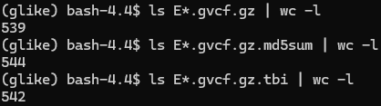

# 20261005

## Summary
* Code implementation changes to correct workflow for 546 WGS MEC-NH (`snpArcher`)
* Code implementation changes for `tsdate variational_gamma()`

## `snpArcher` workflow changes
We want to incorporate a CCDG-style variant-filtering methodology for the **Variant Quality Score Recalibration (VQSR)**.
* The note provided by Nate Stitzel is "VQSR, the training was done using hapmap, Omni, and 1000G high confidence SNPs"

The aim is to use established, high-confidence variant datasets as a training / ground-truth resource for the VQSR model. The training resources suggested are:
* HapMap (high-confidence well-characterized set of human genetic variation)
* Omni (Illumina Omni genotyping array resource)
* 1000Genomes high confidence SNPs (1000Genomes Project, high-confidence set of variants)

### Sidenote:
* 
* We're missing some of the 546 `.gvcf` files (along with other supplementary files)

### Current workflow
```
joint-called cohort VCF --> variant_filtration --> postprocess_basic_filter --> postprocess_strict_filter --> downstream SNP/sample QC
```

### Proposed VQSR integration
```
539 (?) per-sample gVCFs --> GATK GenomicsDB (joint genotyping) --> cohort-level VCF --> Variant Recalibrator
```
* Train on:
    * HapMap
    * Omni
    * 1000Genomes high-confidence SNPs

```
ApplyVQSR --> recalibrated high-confidence variant set --> sample-level QC --> SNP/INDEL processing --> PLINK / ADMIXTURE QC
```
Perfectly replicating the CCDG workflow for this VQSR integration would require matching the:
* exact training resources
  * HapMap (done)
  * Omni (done)
  * 1000Genomes (**Phase3**) -- Needs to be updated
  * dbSNP (GenomicsDB)
* resource annotations
  * AS_QD (Quality by Depth)
  * AS_MQ (Mapping Quality)
  * AS_FS (Fisher Strand)
  * AS_SOR (Strand Odds Ratio)
  * AS_MQRankSum (MQRankSum)
  * AS_ReadPosRankSum (ReadPosRankSum)
* variant annotations (done)
* recalibration thresholds (done)
* resource metadata

### VQSR implementation: Snakefile
```
from pathlib import Path
import os

configfile: "/project2/mahj_1946/MEC_WGS_NH_546_gvcf/config/config.yaml"

include: "rules/common.smk"
include: "rules/reference.smk"
include: "rules/intervals.smk"
include: "rules/fastq.smk"
include: "rules/mapping.smk"
include: "rules/qc_metrics.smk"
include: "rules/callable_sites.smk"
include: "rules/vqsr.smk"
```
* `rule vqsr_recalibrate_snps`
* `rule vqsr_apply_snps`
* `rule vqsr_recalibrate_indels`
* `rule vqsr_apply_indels`

### VQSR implementation: vqsr.yaml
```
snp:

  annotations:
    - AS_QD
    - AS_MQ
    - AS_MQRankSum
    - AS_ReadPosRankSum
    - AS_FS
    - AS_SOR

  truth_sensitivity: 99.8

  resources:

    hapmap:
      path: "/project2/mahj_1946/MEC_WGS_NH_546_gvcf/resources/vqsr/hapmap_3.3.hg38.sites.vcf.gz"
      index: "/project2/mahj_1946/MEC_WGS_NH_546_gvcf/resources/vqsr/hapmap_3.3.hg38.sites.vcf.gz.tbi"
      known: false
      training: true
      truth: true
      prior: 15.0

    omni:
      path: "/project2/mahj_1946/MEC_WGS_NH_546_gvcf/resources/vqsr/1000G_omni2.5.hg38.sites.vcf.gz"
      index: "/project2/mahj_1946/MEC_WGS_NH_546_gvcf/resources/vqsr/1000G_omni2.5.hg38.sites.vcf.gz.tbi"
      known: false
      training: true
      truth: false
      prior: 12.0

    thousand_genomes:
      path: "/project2/mahj_1946/MEC_WGS_NH_546_gvcf/resources/vqsr/1000G_phase1.snps.high_confidence.hg38.vcf.gz"
      index: "/project2/mahj_1946/MEC_WGS_NH_546_gvcf/resources/vqsr/1000G_phase1.snps.high_confidence.hg38.vcf.gz.tbi"
      known: false
      training: true
      truth: false
      prior: 10.0


indel:

  annotations:
    - AS_QD
    - AS_MQRankSum
    - AS_ReadPosRankSum
    - AS_FS
    - AS_SOR

  truth_sensitivity: 99.0

  resources:

    mills:
      path: "/project2/mahj_1946/MEC_WGS_NH_546_gvcf/resources/vqsr/Mills_and_1000G_gold_standard.indels.hg38.vcf.gz"
      index: "/project2/mahj_1946/MEC_WGS_NH_546_gvcf/resources/vqsr/Mills_and_1000G_gold_standard.indels.hg38.vcf.gz.tbi"
      known: false
      training: true
      truth: true
      prior: 12.0

    axiom:
      path: "/project2/mahj_1946/MEC_WGS_NH_546_gvcf/resources/vqsr/Axiom_Exome_Plus.genotypes.all_populations.poly.hg38.vcf.gz"
      index: "/project2/mahj_1946/MEC_WGS_NH_546_gvcf/resources/vqsr/Axiom_Exome_Plus.genotypes.all_populations.poly.hg38.vcf.gz.tbi"
      known: false
      training: true
      truth: false
      prior: 10.0
```
Allele-specific annotations

### VQSR Input Files
```
51M     1000G_omni2.5.hg38.vcf.gz
1.5M    1000G_omni2.5.hg38.vcf.gz.tbi
1.8G    1000G_phase1.snps.high_confidence.hg38.vcf.gz
2.1M    1000G_phase1.snps.high_confidence.hg38.vcf.gz.tbi
60M     hapmap_3.3.hg38.vcf.gz
1.5M    hapmap_3.3.hg38.vcf.gz.tbi
```

* Downloaded from : `https://console.cloud.google.com/storage/browser/gcp-public-data--broad-references/hg38/v0`
* Matches same format as given reference `.fasta`

## `tsdate variational_gamma()` [Running]
* Testcase on 350 NH WGS samples (`/project2/jitang_1167/projects/smallTask/phase_nh_wgs/CEU_CHB-CHS_YRI_NH-WGS_phased/phased`)

### array_5388 data correction [Implemented]
* Goal: Combine MEGA and GDA array data into one set
* Retain all individuals in MEGA data
* Remove any duplicate individuals from GDA
* Convert both sets of Sample IDs to primary MEC-IDS to determine overlap
* Restrict both datasets to variants shared by two arrays
* Merge samples using `PLINK`
* Write one `.vcf.gz` per relevant chromosome to `/project2/mahj_1946/variational_gamma/Data/array_5388/` <-- I am here
* Process chromosomes 2, 3, 5, and 16 moving forward

### meta-imputed 5668 [WIP]
* TODO: Remove all indels / structural variants
* TODO: Keep most common allele if a site has more than one alternate allele
* Confirmed: duplicate site positions are from multiple allelic variants, not from overlapping of chunking when applying ancestral array